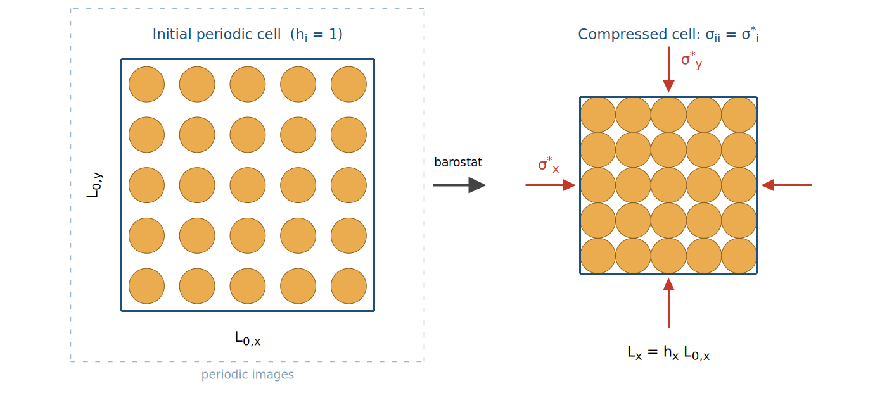
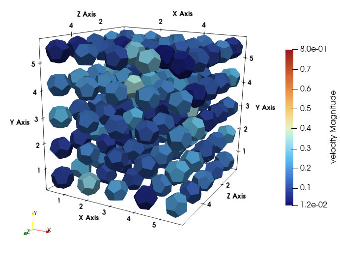
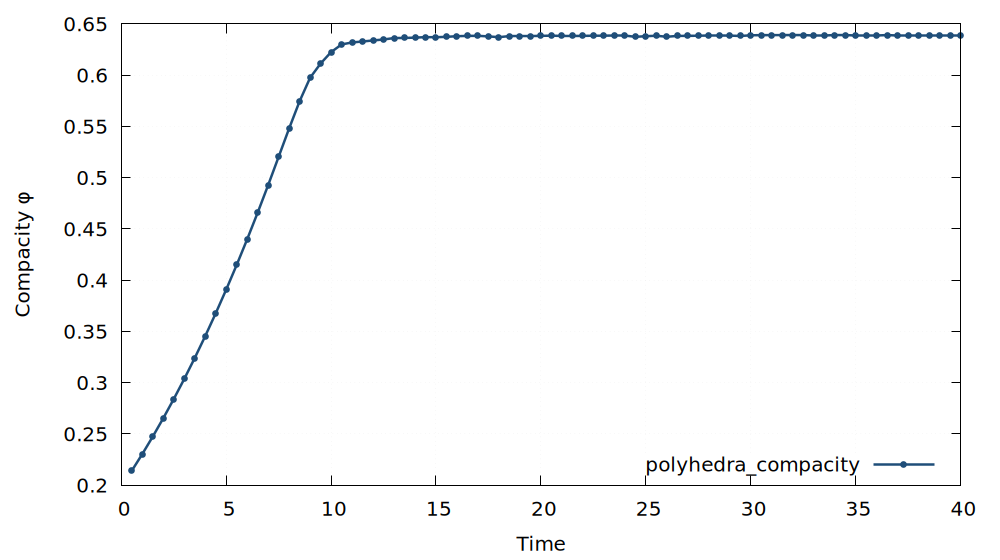
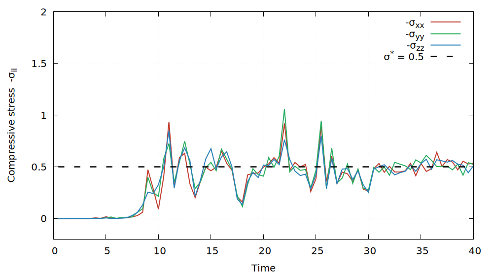

.. _exadem_barostat:

========
Barostat
========

The ``barostat`` plugin turns the periodic simulation cell into a **dynamical degree of freedom**: the size of the cell along each periodic axis evolves in time, driven by the difference between the measured stress of the granular assembly and a target stress imposed by the user. The typical use is a **stress-controlled tri-periodic compression**: a loose packing is compressed until the mean stress reaches a prescribed value, without any wall, which avoids wall effects on the packing structure.

The design follows Rockable's ``PeriodicCell`` and ``cellControl``. Only the diagonal of the cell is controlled (axial deformation, no shear), and non-periodic axes are left untouched.

.. contents::
   :local:
   :depth: 2

.. _barostat_principle:

Principle
=========

Periodic cell and deformation
-----------------------------

In ``exaDEM`` the particle positions are stored in a reference (grid) space and mapped to physical space through the domain transformation ``xform``, a :math:`3\times3` matrix. The barostat only uses the diagonal of this matrix:

.. math::

   \mathbf{H} = \mathrm{diag}(h_x, h_y, h_z), \qquad
   L_i = h_i\, L_{0,i}, \qquad
   V = h_x h_y h_z\, L_{0,x} L_{0,y} L_{0,z}

where :math:`L_{0,i}` is the size of the domain given in ``domain: bounds``, :math:`h_i` is dimensionless (equal to 1 at startup), :math:`L_i` is the current physical length of the cell along axis :math:`i` and :math:`V` is the cell volume (computed by ``domain_volume``). Changing :math:`h_i` moves every particle affinely with the cell and changes the distance between the periodic images, which loads the contacts.

  Stress-controlled compression of a periodic cell: the cell lengths :math:`L_i = h_i L_{0,i}` shrink until the measured stress :math:`\sigma_{ii}` matches the target :math:`\sigma^*_i`.

Measured stress
---------------

The stress of the assembly is the average (Love-Weber) stress tensor computed from the contact forces :math:`\mathbf{f}_c` and the branch vectors :math:`\mathbf{b}_c` (from the particle center to the contact point):

.. math::

   \boldsymbol{\sigma} = \frac{1}{V} \sum_{p} \sum_{c \in p} \mathbf{f}_c \otimes \mathbf{b}_c

The per-particle contribution is computed by ``stress_tensor`` (field ``stress``) and reduced over the whole domain by ``avg_stress_tensor``. With this convention a **compressive** stress has **negative** diagonal components.

Equation of motion of the cell
------------------------------

Each periodic axis :math:`i` behaves as a particle of fictive mass :math:`m` and viscous damping :math:`c`. The driving force is the stress mismatch multiplied by the area of the face normal to :math:`i`, :math:`V / L_i`:

.. math::

   m\, \ddot h_i = \frac{V}{L_i}\left( -\sigma_{ii} - \sigma^*_i \right) - c\, \dot h_i

where :math:`\sigma^*_i` is the target stress ``cell_sig`` (compressive is **positive**), :math:`m` is ``cell_mass`` and :math:`c` is ``cell_damping``. While the assembly is less loaded than requested (:math:`-\sigma_{ii} < \sigma^*_i`), :math:`\ddot h_i < 0` and the cell shrinks; once the packing is jammed the contact forces build up until :math:`-\sigma_{ii} = \sigma^*_i` and the cell stops.

.. note::

  :math:`h_i` is dimensionless while the right-hand side is a force, so ``cell_mass`` is a fictive parameter with units of force :math:`\times` time\ :sup:`2`. It has no physical meaning and must be tuned (see :ref:`barostat_tuning`).

Time integration
----------------

The cell is integrated with the same velocity-Verlet splitting as the particles, in two halves that surround the force computation. With :math:`v_i = \dot h_i` (slot ``cell_vh``) and :math:`a_i = \ddot h_i` (slot ``cell_ah``):

``cell_barostat_prolog`` (before the neighbor update and ``compute_force``):

.. math::

   h_i^{n+1} &= h_i^{n} + \Delta t\, v_i^{n} + \tfrac12\, \Delta t^2\, a_i^{n} \\
   v_i^{n+1/2} &= v_i^{n} + \tfrac12\, \Delta t\, a_i^{n}

``cell_barostat_epilog`` (after the stress tensor of the new configuration has been computed):

.. math::

   a_i^{n+1} &= \frac{1}{m}\left[ \frac{V^{n+1}}{L_i^{n+1}}\left( -\sigma_{ii}^{n+1} - \sigma^*_i \right) - c\, v_i^{n+1/2} \right] \\
   v_i^{n+1} &= v_i^{n+1/2} + \tfrac12\, \Delta t\, a_i^{n+1}

The prolog stops the simulation if a cell length becomes non-finite or non-positive, or if :math:`h_i < 10^{-6}` (collapsed cell, usually because :math:`\sigma^*` is unreachable with the current contact stiffness or because ``cell_mass``/``cell_damping`` are too small for ``dt``).

Example: tri-periodic compression of dodecahedra
------------------------------------------------

The example ``example/polyhedra/triperiodic_compression`` compresses 125 dodecahedra, initially placed on a simple cubic lattice in a :math:`6\times6\times6` tri-periodic box, under an isotropic target stress :math:`\sigma^* = 0.5`. The particles have random orientations and random initial velocities.

.. code-block:: bash

  cd build-exaDEM/example/polyhedra/triperiodic_compression
  ../../../exaDEM triperiodic_compression.msp

  Tri-periodic compression of 125 dodecahedra (colored by velocity magnitude), from :math:`\phi \approx 0.21` to :math:`\phi \approx 0.64`.

The cell first shrinks at nearly constant speed while the particles are not in contact (:math:`\sigma \approx 0`). Around :math:`t \approx 9` the packing jams, the stress rises and oscillates around the target, then settles at :math:`-\sigma_{ii} \approx \sigma^*` (see :ref:`barostat_analyses`).

.. _barostat_setup:

Setup
=====

Include the configuration file
------------------------------

The barostat is opt-in. Include ``config_barostat.msp`` **after** the particle configuration file (``config_spheres.msp`` or ``config_polyhedra.msp``), and make all the controlled axes periodic:

.. code-block:: yaml

  includes:
    - config_polyhedra.msp     # or config_spheres.msp
    - config_barostat.msp

  domain:
    cell_size: 3.0
    periodic: [true, true, true]
    bounds: [[0, 0, 0], [6, 6, 6]]
    expandable: false

``config_barostat.msp`` redefines the numerical scheme to insert the cell integration around the force computation:

.. code-block:: yaml

  numerical_scheme_verlet_macro:
    name: scheme
    body:
      - combined_compute_prolog
      - push_f_v_r_driver: { dt_scale: 1.0 }
      - push_f_v_driver: { dt_scale: 0.5 }
      - push_av_to_quat_driver : { dt_scale: 1.0 }
      - cell_barostat_prolog      # move the cell: h(n) -> h(n+1)
      - nbh_dist                  # the cell changes at each step: update the neighbor distance in grid space
      - check_and_update_particles
      - reset_force_driver
      - reset_force_moment
      - compute_force
      - freeze
      - compute_stress_tensor     # per-particle stress (field stress)
      - compute_barostat          # measured stress + cell acceleration
      - force_to_accel
      - force_to_accel_driver
      - push_f_v_driver: { dt_scale: 0.5 }
      - combined_compute_epilog

Since the cell size changes at every step, ``nbh_dist`` recomputes the neighbor search distance and the ghost layer thickness in grid space after each cell update: in grid space, the same physical cutoff gets larger when the cell shrinks. Without it, these distances would keep their initial values and contacts could be missed during the compression.

Set the target stress
---------------------

``config_barostat.msp`` defines ``compute_barostat`` with a zero target. Redefine it in your input file:

.. code-block:: yaml

  compute_barostat:
    - domain_volume              # cell volume V
    - avg_stress_tensor          # average stress tensor sigma (uses V)
    - cell_barostat_epilog:
       cell_sig: [ 0.5, 0.5, 0.5 ]  # target stress per axis, compressive is positive
       cell_mass: 36.0
       cell_damping: 360.0

.. warning::

  ``cell_sig`` must be given inline on ``cell_barostat_epilog`` as above. A bracketed list in the ``global`` block is parsed as ``vector<double>``, which does not match the ``Vec3d`` type of the slot.

Different values per axis give an anisotropic (triaxial, stress-controlled) loading, e.g. ``cell_sig: [ 1.0, 0.5, 0.5 ]``.

Operators
---------

.. list-table::
   :header-rows: 1
   :widths: 22 78

   * - Operator
     - Description
   * - ``cell_barostat_prolog``
     - Drift and first half-kick of the cell. Updates the diagonal of ``xform``. Must run once per step, before ``compute_force``.
   * - ``cell_barostat_epilog``
     - New cell acceleration and second half-kick. Must run once per step, after the stress tensor has been recomputed.
   * - ``domain_volume``
     - Computes the cell volume :math:`V` (slot ``volume``).
   * - ``avg_stress_tensor``
     - Computes the average stress tensor :math:`\boldsymbol\sigma` (slot ``stress_tensor``) from the per-particle stresses.

Parameters of ``cell_barostat_epilog``:

.. list-table::
   :header-rows: 1
   :widths: 16 12 10 62

   * - Name
     - Type
     - Default
     - Description
   * - ``cell_sig``
     - Vec3d
     - required
     - Target normal stress per axis :math:`\sigma^*_i`. Compressive is positive.
   * - ``cell_mass``
     - double
     - required
     - Fictive mass :math:`m` of the cell. Larger values give a slower, smoother response.
   * - ``cell_damping``
     - double
     - 0.0
     - Viscous damping :math:`c` on the cell velocity. With 0 the cell oscillates around the target stress.

The cell velocity and acceleration (slots ``cell_vh`` and ``cell_ah``) are kept from one step to the next and start at zero. They are not written in the restart files: after a restart the cell starts again with a zero velocity, from the ``xform`` stored in the dump.

.. _barostat_tuning:

Tuning
------

* ``cell_mass`` and ``cell_damping`` have no general formula and must be tuned for each system. The ratio :math:`m/c` is the relaxation time of the cell velocity (0.1 in the example above); it should be large compared to ``dt`` and small compared to the duration of the compression.
* A too small ``cell_mass`` makes the cell react faster than the contacts can transmit the load: the stress overshoots, oscillates, and the cell can collapse.
* A too small ``cell_damping`` leaves the stress oscillating around the target; increase it to settle without overshoot.
* The target stress must be reachable with the contact stiffness: :math:`\sigma^*` should give overlaps small compared to the particle size (:math:`\sigma^* d / k_n \ll 1`).

Cell size check
---------------

Compressing the cell also shrinks the grid cells in physical space (:math:`\mathrm{cell\_size} \times \min_i h_i`). The neighbor search requires the largest particle diameter to stay smaller than this size. ``config_spheres.msp`` and ``config_polyhedra.msp`` plug ``check_sphere_cell_size`` and ``check_polyhedra_cell_size`` in ``check_cell_size``, which is called at every neighbor list update and stops the simulation with an explicit message when the cells become too small. Choose ``cell_size`` so that ``cell_size`` :math:`\times\, h_{\min}` remains larger than the largest diameter at the end of the compression. In the example, :math:`h` goes from 1 to about 0.68, giving physical cells of about 2.0 for particles of diameter about 1.

.. _barostat_analyses:

Analyses
========

The compression is usually followed through the compacity (solid fraction) and the average stress tensor. These operators are added to the ``analyses`` block, executed every ``simulation_analyses_frequency`` steps; their outputs are written in ``<dir_name>/ExaDEMAnalyses``.

.. code-block:: yaml

  analyses:
    - domain_volume
    - polyhedra_compacity     # or sphere_compacity

  global:
    simulation_analyses_frequency: 5000
    analysis_dump_stress_tensor_frequency: 5000

Compacity
---------

The compacity :math:`\phi` is the ratio between the volume of the particles and the volume of the cell:

.. math::

   \phi = \frac{1}{V} \sum_{p} V_p, \qquad
   V_p = \begin{cases}
     \tfrac43 \pi r_p^3 & \text{spheres} \\
     h_p^3\, V_{\text{shape}(p)} & \text{polyhedra}
   \end{cases}

where :math:`h_p` is the homothety of the polyhedron. Both operators require the cell volume :math:`V`, so ``domain_volume`` must be called first. The sums are reduced in parallel (OpenMP / GPU and MPI) on the real (non-ghost) particles.

.. list-table::
   :header-rows: 1
   :widths: 22 24 54

   * - Operator
     - Output file
     - Columns
   * - ``sphere_compacity``
     - ``SphereCompacity.txt``
     - ``Time NbParticles MeanRadius Compacity``
   * - ``polyhedra_compacity``
     - ``PolyhedraCompacity.txt``
     - ``Time NbParticles SolidVolume Compacity``

The output file name can be changed with the ``name`` parameter. Plot it with gnuplot:

.. code-block:: bash

  gnuplot -p -e "set xlabel 'Time'; set ylabel 'Compacity'; \
    plot 'PolyhedraTriperiodicCompressionDir/ExaDEMAnalyses/PolyhedraCompacity.txt' u 1:4 every ::1 w lp t ''"

  Compacity during the tri-periodic compression of dodecahedra: it increases linearly while the cell shrinks freely, then saturates at :math:`\phi \approx 0.64` once the packing is jammed.

Stress tensor
-------------

With ``analysis_dump_stress_tensor_frequency`` set, the average stress tensor is written in ``<dir_name>/AvgStressTensor.txt`` (columns ``Time Sxx Sxy Sxz Syx Syy Syz Szx Szy Szz``, see :doc:`post_processings`). For a converged compression, the diagonal satisfies :math:`-\sigma_{ii} \approx \sigma^*_i` and the off-diagonal terms fluctuate around zero.

.. code-block:: bash

  gnuplot -p -e "plot 'PolyhedraTriperiodicCompressionDir/AvgStressTensor.txt' u 1:(-\$2) w l t '-Sxx', \
    '' u 1:(-\$6) w l t '-Syy', '' u 1:(-\$10) w l t '-Szz', 0.5 dt 2 t 'target'"

  Diagonal of the average stress tensor (compressive positive) versus the target :math:`\sigma^* = 0.5`: zero before jamming, oscillations when the packing jams, then convergence to the target.

Contact statistics (spheres)
----------------------------

For sphere packings, ``sphere_contact_stats`` gives the micromechanical state of the compressed packing, written in ``SphereContactStats.txt`` (columns ``Time NbContacts CoordinationNumber MeanContactForce``):

.. math::

   Z = \frac{2 N_c}{N_p}, \qquad
   \langle f_n \rangle = \frac{1}{N_c} \sum_{c} \lVert \mathbf{f}_{n,c} \rVert

where :math:`N_c` is the number of active sphere-sphere contacts (overlap :math:`\delta_n < 0`), each counted once, and :math:`N_p` is the number of real particles.

.. code-block:: yaml

  analyses:
    - domain_volume
    - sphere_compacity
    - sphere_contact_stats

Regression test
---------------

The example is also a regression test (``Example_ExaDEM_PolyhedraTriperiodicCompression``, sequential, OpenMP and MPI runs). The script ``check_compacity.py`` reads ``PolyhedraCompacity.txt`` and checks that the number of particles and the solid volume are conserved, that the compacity increases at every output, and that it exceeds 0.26 at the end of the shortened run (t = 2):

.. code-block:: bash

  cd build-exaDEM
  ctest -R PolyhedraTriperiodicCompression
