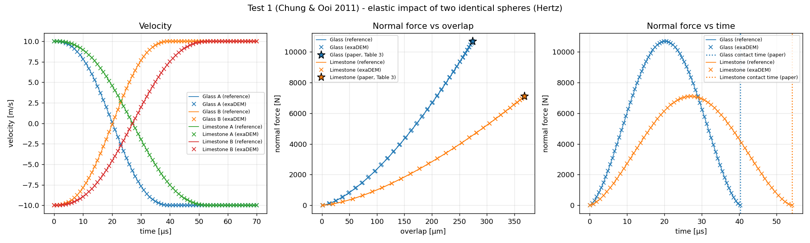
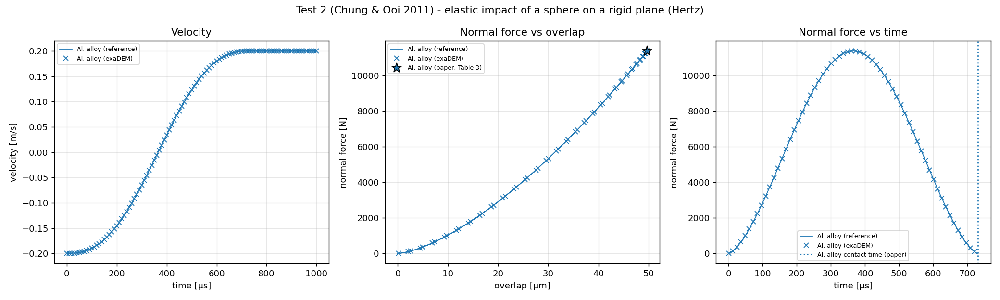
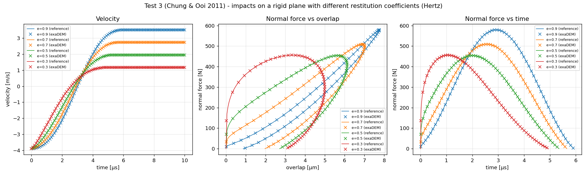

Force Field
===========

The force field encompasses a broader set of operators and mechanisms responsible for computing forces acting on particles within the particle environment. It includes various types of forces such as gravitational forces, contact forces, and other external influences that affect particle dynamics.

Contact Force Laws
------------------

A **contact law**, in the context of the Discrete Element Method (DEM), is the principle used to calculate the force between two particles from their relative displacement. In DEM simulations, a contact law models the interaction between particles, capturing elastic deformation and linear force behaviors.

There are two kinds of interaction:

- pure contact interaction
- cohesive interaction

The main laws available in exaDEM are:

+--------------+----------------+------------------------------------------------------------------------------------------------------------------------------------+
| Name         | type           | Description                                                                                                                        |
+==============+================+====================================================================================================================================+
| ``hooke``    | pure contact   | Default configuration : elastic linear normal force, normal viscosity force, Coulomb friction tangent force and rolling resistance |
+--------------+----------------+------------------------------------------------------------------------------------------------------------------------------------+
| ``hertz``    | pure contact   | Spheres only: elastic non-linear (Hertz) normal force defined from the materials (Young modulus, Poisson ratio), normal viscosity  |
|              |                | force, Coulomb friction tangent force and rolling resistance                                                                       |
+--------------+----------------+------------------------------------------------------------------------------------------------------------------------------------+
| ``cohesive`` | Cohesive       | Addition of a normal cohesive force depending on the distance between particles                                                    |
+--------------+----------------+------------------------------------------------------------------------------------------------------------------------------------+
| ``dmt``      | Cohesive       | Addition of an adhesive law at contact to model Van der Waals force for hard particles                                             |
+--------------+----------------+------------------------------------------------------------------------------------------------------------------------------------+

The variables required to describe interactions are:

.. list-table::
   :widths: 25 75
   :header-rows: 1

   * - Variable
     - Description
   * - :math:`cp`
     - The contact position
   * - :math:`r_i`
     - The position of particle :math:`i`
   * - :math:`r_j`
     - The position of particle :math:`j`
   * - :math:`v_i`
     - The velocity of particle :math:`i`
   * - :math:`v_j`
     - The velocity of particle :math:`j`
   * - :math:`vrot_i`
     - The angular velocity of particle :math:`i`
   * - :math:`vrot_j`
     - The angular velocity of particle :math:`j`
   * - :math:`m_i`
     - The mass of particle :math:`i`
   * - :math:`m_j`
     - The mass of particle :math:`j`
   * - :math:`\delta_n`
     - The interpenetration / particle overlap

Each kind of interaction also requires additional constants, reflecting for most of them mechanical properties:

.. list-table::
   :widths: 25 75
   :header-rows: 1

   * - Constant
     - Description
   * - :math:`\Delta_t`
     - The timestep increment
   * - :math:`\alpha_n`
     - The damping rate
   * - :math:`k_n`
     - The normal stiffness coefficient
   * - :math:`k_t`
     - The tangential stiffness coefficient
   * - :math:`v_t`
     - The relative tangential velocity
   * - :math:`k_r`
     - The rotational stiffness coefficient
   * - :math:`\mu`
     - The coefficient of friction

``hooke`` law: elastic normal force with tangential friction
~~~~~~~~~~~~~~~~~~~~~~~~~~~~~~~~~~~~~~~~~~~~~~~~~~~~~~~~~~~~

In the Discrete Element Method (DEM), the equations of motion (translations and rotations) are discretized in time. Only the rigid-body displacements are considered. Small overlaps between the particles are allowed and used as strain variables. The total contact force between particle :math:`i` and particle :math:`j` is given by 

.. math::

 \textbf{f}_{ij} = f_n \textbf{n}  +  \textbf{f}_t

where :math:`f_n` the normal component of the contact force and :math:`\textbf{f}_t` is the tangential force vector. These forces are expressed in the local contact frame :math:`(\textbf{n},\textbf{t},\textbf{s})` as a function of the overlaps and tangential displacements. They are calculated from force laws that generally describe frictional contact interactions. An important feature of DEM is to allow the particles to overlap. This overlap :math:`\delta_n` represents a normal strain localized in the vicinity of the contact point. A simple linear relation is assumed between normal contact force and :math:`\delta_n` . This is consistent with the fact that the overlaps allow for a penalty-based explicit formulation of particle motions, i.e., the elastic repulsion force is mobilized to prevent penalizing the overlap. The condition of particle undeformability implies that the overlaps must stay small compared to particle size. In this linear approximation, the normal component of the contact force is given by 

.. math::

  f_n =  - k_n \delta_n + \nu_n v_n

where :math:`k_n` is the normal stiffness coefficient, :math:`v_n` the normal component of the relative velocity (between particle :math:`i` and particle :math:`j`), and :math:`\nu_n` is the viscous damping coefficient. 
:math:`\nu_n` is related to the restitution coefficient :math:`e_n` by 

.. math::

  \nu_n = \alpha_n \sqrt{2 m_{\text{eff}} v_n}

  \alpha_n = \frac{- \ln{e_n}}{\sqrt{\ln^2{e_n} + \pi^2}}

where:

- :math:`\nu_n` is the viscous damping rate during the collision
- :math:`\alpha_n` is the damping parameter, calculated from the restitution coefficient :math:`e_n`
- :math:`m_{\text{eff}}` is the effective mass of the two colliding particles, defined by :math:`m_{\text{eff}} = \frac{m_i m_j}{m_i + m_j}`

.. note::
 
  The formulas are identical to those used in Rockable (see `Rockable Force Laws <https://richefeu.github.io/rockable/forceLaws.html#default-model-keywork-default>`_) but are implemented differently to align with the `exaDEM` data structure.

The tangential force represents the frictional resistance between particles when they slide against each other. This force is calculated based on the relative tangential velocity (:math:`v_t`) and a tangential stiffness parameter (:math:`k_t`, called ``ktContact`` in Rockable).

The **Coulomb friction model** is used to limit the tangential force, ensuring that it does not exceed the product of the friction coefficient :math:`\mu` and the normal force (:math:`f_n`):

.. math::

    f_t \leq \mu \cdot f_n

The tangential force :math:`f_t` is incrementally updated at each time step according to the following relation, starting from the onset of contact:

.. math::

    f_t = f_t + k_t \cdot v_t \cdot \Delta t

where:

- :math:`f_t` is the tangential force,
- :math:`k_t` is the tangential stiffness,
- :math:`v_t` is the relative tangential velocity, and
- :math:`\delta t` is the time step.

The friction force is reset to zero as soon as contact is lost.

.. _force_field_hertz_law:

``hertz`` law: non-linear elastic normal force (spheres)
~~~~~~~~~~~~~~~~~~~~~~~~~~~~~~~~~~~~~~~~~~~~~~~~~~~~~~~~

The ``hertz`` law is available for spheres only. Unlike the ``hooke`` law, the normal stiffness is not a parameter: it depends on the overlap, on the radii of the particles and on the materials in contact. The materials are described by their Young modulus :math:`E` and their Poisson ratio :math:`\nu`.

The additional variables and constants of this law are:

.. list-table::
   :widths: 25 75
   :header-rows: 1

   * - Variable / Constant
     - Description
   * - :math:`\delta = -\delta_n`
     - The overlap (positive in case of contact)
   * - :math:`E_i`, :math:`\nu_i`
     - The Young modulus and the Poisson ratio of the material of particle (or driver) :math:`i`
   * - :math:`E^*`
     - The reduced Young modulus of the contact
   * - :math:`R^*`
     - The effective radius of the contact
   * - :math:`m^*`
     - The effective mass of the contact
   * - :math:`\zeta`
     - The damping ratio (``damp_rate``)

with:

.. math::

  \frac{1}{E^*} = \frac{1 - \nu_i^2}{E_i} + \frac{1 - \nu_j^2}{E_j}, \qquad
  R^* = \frac{R_i R_j}{R_i + R_j}, \qquad
  m^* = \frac{m_i m_j}{m_i + m_j}

The normal force is the sum of the elastic Hertz force :math:`f_e` and of a viscous damping force, and it is never attractive:

.. math::

  f_e = \frac{4}{3} E^* \sqrt{R^*} \, \delta^{3/2}

  f_n = \max\left(0, \; f_e + c \, v_n\right)

where :math:`v_n` is the normal component of the relative velocity. The damping coefficient :math:`c` is computed from the tangent stiffness :math:`k` of the contact (the derivative of :math:`f_e` with respect to :math:`\delta`):

.. math::

  k = \frac{d f_e}{d \delta} = 2 E^* \sqrt{R^* \delta}

  c = 2 \zeta \sqrt{m^* k}

The damping coefficient therefore grows with :math:`\delta^{1/4}`. With this damping, the restitution coefficient :math:`e_n` only depends on :math:`\zeta` (not on the velocity, the masses, the radii or :math:`E^*`). The relation between :math:`e_n` and :math:`\zeta` is not the one of the ``hooke`` law; some reference values are:

.. list-table::
   :widths: 30 17 17 17 17
   :header-rows: 0

   * - :math:`e_n`
     - 0.9
     - 0.7
     - 0.5
     - 0.3
   * - :math:`\zeta` (``damp_rate``)
     - 0.0312797
     - 0.1115664
     - 0.2330340
     - 0.4539161

The tangential force and the rolling resistance are the same as for the ``hooke`` law (constant tangential stiffness :math:`k_t`, rotational stiffness :math:`k_r`). The Coulomb limit of the friction is computed from the elastic Hertz force:

.. math::

  \|\textbf{f}_t\| \leq \mu \, f_e

The ``cohesive`` and ``dmt`` laws described below can be combined with the ``hertz`` law, as with the ``hooke`` law (:math:`k_n \delta_n` and the damping term are then replaced by the Hertz normal force).

.. warning::

  The critical time step is not estimated for the ``hertz`` law. The time step must be chosen by the user, e.g. as a small fraction of the Hertz contact time:

  .. math::

    t_c \approx 2.87 \left( \frac{{m^*}^2}{R^* {E^*}^2 v_0} \right)^{1/5}

  with :math:`v_0` the impact velocity.

``cohesive`` law: cohesive normal force
~~~~~~~~~~~~~~~~~~~~~~~~~~~~~~~~~~~~~~~
This interaction requires two additional parameters:

.. list-table::
   :widths: 25 75
   :header-rows: 1

   * - Constant
     - Description
   * - :math:`fc`
     - Cohesive force threshold
   * - :math:`dncut`
     - Distance cutoff for cohesive interaction

There are three cases, depending on the interpenetration :math:`\delta_n` between the two particles:

* :math:`\delta_n < -dncut`
* :math:`-dncut < \delta_n < 0`
* :math:`0 < \delta_n < dncut`

.. warning::

  Cohesive forces (`dncut`) are only applied if you use the operators ``contact_[*]_[*]_[*]_cohesive``. Otherwise we only consider the case :math:`\delta_n < 0.0`.

**Formula between particle i and particle j if** :math:`\delta_n < -dncut` **:**

.. math::

  \textbf{f}_{ij} =  -k_n . \delta_n + \alpha_n \sqrt{2.m_{eff}} v_n + k_t . v_t . \Delta_t

with the effective mass:

.. math::

  m_{eff} = \frac{m_i.m_j}{m_i+m_j}

and the relative velocity norm:

.. math::

  v_n = (v_i - (cp - r_i) \wedge vrot_i) - (v_j - (cp - r_j) \wedge vrot_j) 

**Formula between particle i and particle j if** :math:`-dncut < \delta_n < 0` **:**

.. math::

  \textbf{f}_{ij} = f_n + k_t . v_t . \Delta_t

with:

.. math::

   f_n =\left \{
   \begin{array}{lcl}
   -k_n . \delta_n + \alpha_n \sqrt{2.m_{eff}} v_n  &  if  & -k_n . \delta_n + \alpha_n \sqrt{2.m_{eff}} v_n >= -fc \\
   & & \\
   -fc & if  & -k_n . \delta_n + \alpha_n \sqrt{2.m_{eff}} v_n < -fc 
   \end{array} 
   \right.

**Formula between particle i and particle j if** :math:`0 < \delta_n < dncut` **:**

.. math::

  \textbf{f}_{ij} = (\frac{fc}{dncut} . \delta_n - fc) . \textbf{n}

with **n** the normalized vector from particle i to particle j

``dmt`` law: adhesive normal force (Van der Waals)
~~~~~~~~~~~~~~~~~~~~~~~~~~~~~~~~~~~~~~~~~~~~~~~~~~
DMT (Derjaguin–Muller–Toporov) is usually used to compute pull-off forces (the force needed to split two rigid objects in contact), computed from a global energy balance.
To define it, it needs an additional parameter representing an energy:

.. list-table::
   :widths: 25 75
   :header-rows: 1

   * - Constant
     - Description
   * - :math:`\gamma`
     - Adhesion energy per unit of surface

In case of contact, an additional force :math:`f_{DMT}` is added to the normal force such that :

.. math::
  f_n =  f_n - f_{DMT}

with:

.. math::
  f_{DMT} = 2 \pi R_{eff} \gamma

where the effective radius :math:`R_{eff}` is obtained from the respective radii :math:`R_{i}` and :math:`R_{j}` of the particles i and j:

.. math::
  R_{eff} = \frac{R_i.R_j}{R_i+R_j}

and :math:`\gamma` is the surface energy (linked to Van der Waals forces).

.. note::
   Since DMT force law is added to the normal force, it requires the definition of a pure contact law, such as ``hooke`` or ``hertz``.

.. _force_field_contact_law_operators:

Contact Law Operators
---------------------

Contact Law Operators select a contact law and define its parameters.

The operator naming convention follows the rule below:

::

   contact_[material_mode]_[particle_type]_[pure_contact_law]_[cohesion_law]

Where each field is defined as follows:

.. list-table:: Operator name fields
   :header-rows: 1
   :widths: 25 25 50

   * - Field
     - Possible values
     - Description
   * - [material_mode]
     - ``singlemat``, ``multimat``
     - Material interaction mode
   * - [particle_type]
     - ``sphere``, ``polyhedron``
     - Type of particles
   * - [pure_contact_law]
     - ``hooke``, ``hertz``
     - Pure contact law (``hertz``: spheres only, see below)
   * - [cohesion_law]
     - ``cohesive``, ``dmt``, ``none``
     - Cohesion / adhesion law

.. note::

   For convenience, simplified operator names are available.
   They are strict equivalents of the full naming convention.

   **Sphere operators**

   - ``contact_sphere``  
     is equivalent to  
     ``contact_singlemat_sphere_hooke`` or  
     ``contact_singlemat_sphere_hooke_none``

   - ``contact_multimat_sphere``  
     is equivalent to  
     ``contact_multimat_sphere_hooke_none``

   **Polyhedron operators**

   - ``contact_polyhedron``  
     is equivalent to  
     ``contact_singlemat_polyhedron_hooke`` or  
     ``contact_singlemat_polyhedron_hooke_none``

   - ``contact_multimat_polyhedron``  
     is equivalent to  
     ``contact_multimat_polyhedron_hooke_none``

.. note::

   The ``hertz`` law is defined from the materials of the particles, which are given per group (see :ref:`force_field_hertz_contact_parameters`). It is therefore only available in ``multimat`` mode, and its operators are named:

   ::

      contact_sphere_hertz_[cohesion_law]

   i.e. ``contact_sphere_hertz_none``, ``contact_sphere_hertz_cohesive`` and ``contact_sphere_hertz_dmt``. These operators have no ``config`` / ``config_driver`` parameter: the contact parameters are read from ``multimat_contact_params_hertz`` and ``drivers_contact_params_hertz``.

.. note::

   Contact laws are always symmetric: an interaction between two particles is stored once in the interaction lists, and the contact law computes the force (and moment) of both particles at once.

In a ``hooke`` contact operator, the following parameters can be defined:

+---------------------+------------------------------------------------------------------------------+
| `config`            | Data structure that contains contact force parameters (dncut, kn, kt,        |
|                     | kr, fc, mu, damp_rate). Type = exaDEM::ContactParams. No default parameter.  |
+---------------------+------------------------------------------------------------------------------+
| `config_driver`     | Data structure that contains contact force parameters (dncut, kn, kt,        |
|                     | kr, fc, mu, damp_rate). Type = exaDEM::ContactParams.                        |
|                     | This parameter is optional.                                                  |
+---------------------+------------------------------------------------------------------------------+
| `save_interactions` | Store interactions into the classifier data structure. Default is false.     |
+---------------------+------------------------------------------------------------------------------+

Here are four YAML examples:

.. code-block:: yaml

   - contact_sphere:
      config: { kn: 100000, kt: 100000, kr: 0.1, mu: 0.9, damp_rate: 0.9}

.. code-block:: yaml

   - contact_polyhedron:
      config: { kn: 10000, kt: 10000, kr: 0.1, mu: 0.1, damp_rate: 0.9}
      config_driver: { kn: 10000, kt: 10000, kr: 0.1, mu: 0.3, damp_rate: 0.9}

.. code-block:: yaml

   - contact_singlemat_sphere_hooke_cohesive:
      config: { dncut: 0.1 m, kn: 100000, kt: 100000, kr: 0.1, fc: 0.05, mu: 0.9, damp_rate: 0.9}

.. code-block:: yaml

   - contact_singlemat_polyhedron_hooke_cohesive:
      config: { dncut: 0.1 m, kn: 10000, kt: 10000, kr: 0.1, fc: 0.05, mu: 0.1, damp_rate: 0.9}
      config_driver: { dncut: 0.1 m, kn: 10000, kt: 10000, kr: 0.1, fc: 0.05, mu: 0.3, damp_rate: 0.9}

.. code-block:: yaml

  - contact_singlemat_sphere_hooke_dmt:
     config: { kn: 1000, kt: 1000, kr: 0.1,mu: 0.2, damp_rate: 0.9, gamma: 10.}
     config_driver: { kn: 1000, kt: 800, kr: 0.1,mu: 0.5, damp_rate: 0.9, gamma: 10.}

.. code-block:: yaml

  - contact_sphere_hertz_none

.. note::

  The cohesion law ([cohesion_law] = ``cohesive``) adds a cohesion force between `rcut` and `rcut+dncut`, scaled by the cohesion force parameter `fc`.

.. note::

  - The ``contact_[*]_sphere_[*]_[*]``  operators are designed to process interactions built in ``nbh_sphere`` (please, include the config_spheres.msp file).
  - The ``contact_[*]_polyhedron_[*]_[*]`` operators are designed to process interactions built in ``nbh_polyhedron`` (please, include the config_polyhedra.msp file). For the list of polyhedron interaction types these operators process, see :ref:`interaction_type_poly` on the R-Shape / Polyhedron page.

.. _force_field_multi_material:

Multi-Material
--------------

In the previous section, the contact law used the same parameters for every interaction (``singlemat`` mode). It is also possible to make the contact law depend on the group of the interacting particles (``multimat`` mode). This section explains how to define contact-law values between particles, as well as between particles and drivers.

.. note::

   For the ``hooke`` law, unlike in some other DEM codes, the coefficients are **not** derived from the material
   properties (such as Poisson’s ratio and Young’s modulus). For the ``hertz`` law, the normal force is derived
   from the Young modulus and the Poisson ratio of each group, see :ref:`force_field_hertz_contact_parameters`.

.. note::

   Since ``exaDEM-1.2.3``, multi-material contact parameters are indexed by ``group`` (an integer, see the ``group`` particle field in the Particle Fields page) instead of directly by particle ``type``. Before ``1.2.3``, the particle ``type`` was used directly. This decouples the shape/material identity (``type``) from the contact-law identity (``group``): several particle types can share the same group and therefore reuse the same contact parameters. Groups must be assigned beforehand, either with the ``group`` parameter of ``set_fields`` or with the dedicated ``set_group`` operator (see the Particle Fields page).

To handle multiple particle groups, use one of the ``contact_multimat_[*]_[*]_[*]`` operators, as illustrated below.

* **YAML example for polyhedra:**

.. code-block:: yaml

   compute_force:
     - gravity_force
     - contact_multimat_polyhedron

* **YAML example for spheres:**

.. code-block:: yaml

   compute_force:
     - gravity_force
     - contact_multimat_sphere

* **YAML example for spheres with the** ``hertz`` **law:**

.. code-block:: yaml

   compute_force:
     - gravity_force
     - contact_sphere_hertz_none

The following examples illustrate the definition of contact parameters for two particle
groups (**group 0**, **group 1**) and a driver identified by **0**.

Particle-Particle Contact Parameters
~~~~~~~~~~~~~~~~~~~~~~~~~~~~~~~~~~~~

* **Operator Name:** ``multimat_contact_params``
* **Description:** This operator defines the contact law parameters between different particle groups.

+--------------------+---------------------------------------------------------------+
| **Parameter**      | **Description**                                               |
+====================+===============================================================+
| ``group1``         | List of the first particle group indice(s).                   |
+--------------------+---------------------------------------------------------------+
| ``group2``         | List of the second particle group indice(s).                  |
+--------------------+---------------------------------------------------------------+
| ``kn``             | Normal force coefficient for the specified interaction type.  |
+--------------------+---------------------------------------------------------------+
| ``kt``             | Tangential force coefficient for the specified interaction    |
|                    | type.                                                         |
+--------------------+---------------------------------------------------------------+
| ``kr``             | Rolling resistance coefficient for the specified              |
|                    | interaction type.                                             |
+--------------------+---------------------------------------------------------------+
| ``mu``             | Friction coefficient for the specified interaction type.      |
+--------------------+---------------------------------------------------------------+
| ``damprate``       | Damping rate coefficient for the specified interaction type.  |
+--------------------+---------------------------------------------------------------+
| ``default_config`` | Applies the same parameter set to all undefined               |
|                    | interaction configurations.                                   |
+--------------------+---------------------------------------------------------------+
| ``n_groups``       | Number of distinct groups (``INPUT_OUTPUT``, since            |
|                    | ``1.2.3``). Usually left unset: it is then deduced from       |
|                    | ``group1``/``group2`` (max index + 1). If it was already set  |
|                    | upstream (e.g. by ``set_group``), it is checked against       |
|                    | ``group1``/``group2`` instead, and a ``default_config`` must  |
|                    | be provided to cover any group pair not listed explicitly.    |
+--------------------+---------------------------------------------------------------+

.. note::

   ``group1``/``group2`` replace the former ``mat1``/``mat2`` parameters (pre-``1.2.3``, which took particle type names directly). Particle groups must be assigned beforehand via the ``group`` parameter of ``set_fields`` or the ``set_group`` operator.

YAML example:

.. code-block:: yaml

  - multimat_contact_params:
     group1:    [      0,     0,     1 ]
     group2:    [      0,     1,     1 ]
     kn:        [   5000, 10000, 15000 ]
     kt:        [   4000,  8000, 12000 ]
     kr:        [    0.0,   0.0,   0.0 ]
     mu:        [    0.1,   0.2,   0.3 ]
     damprate:  [  0.999, 0.999, 0.999 ]

With `default_config`:

.. code-block:: yaml

  - multimat_contact_params:
     group1:    [      0 ]
     group2:    [      0 ]
     kn:        [   5000 ]
     kt:        [   4000 ]
     kr:        [    0.0 ]
     mu:        [    0.1 ]
     damprate:  [  0.999 ]
     default_config: { kn: 15000, kt: 12000, kr: 0.0, mu: 0.3, damp_rate: 0.999 }

A complete example is available (please report if the link does not work): `rotating-multimat.msp <https://github.com/Collab4exaNBody/exaDEM/blob/main/example/polyhedra/multimat/rotating-multimat.msp>`_

.. _force_field_particle_driver_contact_parameters:

Particle-Driver Contact Parameters
~~~~~~~~~~~~~~~~~~~~~~~~~~~~~~~~~~

* **Operator Name:** ``drivers_contact_params``
* **Description:** This operator defines the contact law parameters between particles and drivers.

* **Parameters:**

+--------------------+---------------------------------------------------------------+
| **Parameter**      | **Description**                                               |
+====================+===============================================================+
| ``group``          | List of particle group indice(s) concerned by the interaction.|
+--------------------+---------------------------------------------------------------+
| ``driver_id``      | Identifier(s) of the driver(s) interacting with the particles.|
+--------------------+---------------------------------------------------------------+
| ``kn``             | Normal force coefficient for the specified interaction type.  |
+--------------------+---------------------------------------------------------------+
| ``kt``             | Tangential force coefficient for the specified interaction    |
|                    | type.                                                         |
+--------------------+---------------------------------------------------------------+
| ``kr``             | Rolling resistance coefficient for the specified              |
|                    | interaction type.                                             |
+--------------------+---------------------------------------------------------------+
| ``mu``             | Friction coefficient for the specified interaction type.      |
+--------------------+---------------------------------------------------------------+
| ``damprate``       | Damping rate coefficient for the specified interaction type.  |
+--------------------+---------------------------------------------------------------+
| ``default_config`` | Applies the same parameter set to all undefined               |
|                    | interaction configurations.                                   |
+--------------------+---------------------------------------------------------------+

.. note::

   ``group`` replaces the former ``mat`` parameter (pre-``1.2.3``, which took particle type names directly). Particle groups must be assigned beforehand via the ``group`` parameter of ``set_fields`` or the ``set_group`` operator.

.. code-block:: yaml

  - drivers_contact_params:
     group:     [      0,     1 ]
     driver_id: [      0,     0 ]
     kn:        [  10000, 15000 ]
     kt:        [   8000, 12000 ]
     kr:        [    0.0,   0.1 ]
     mu:        [    0.5,   0.5 ]
     damprate:  [  0.999, 0.999 ]

A complete example is available (please report if the link does not work): `rotating-multimat.msp <https://github.com/Collab4exaNBody/exaDEM/blob/main/example/polyhedra/multimat/rotating-multimat.msp>`_

.. _force_field_hertz_contact_parameters:

Hertz Contact Parameters
~~~~~~~~~~~~~~~~~~~~~~~~

The ``hertz`` law has its own parameter operators: ``multimat_contact_params_hertz`` (particle-particle) and ``drivers_contact_params_hertz`` (particle-driver). They replace ``multimat_contact_params`` and ``drivers_contact_params`` when the ``contact_sphere_hertz_[*]`` operators are used. There is no ``kn`` parameter: the normal force is defined by the reduced Young modulus :math:`E^*` of each pair, computed from the Young modulus and the Poisson ratio of the materials (see :ref:`force_field_hertz_law`). The other parameters have the same meaning as for the ``hooke`` law.

* **Operator Name:** ``multimat_contact_params_hertz``
* **Description:** This operator defines the Hertz contact law parameters between different particle groups. The materials (``young``, ``poisson``) are given **per group** (one value per group), and :math:`E^*` is computed for every pair of groups. The other lists have one value per listed pair of groups.

+--------------------+---------------------------------------------------------------+
| **Parameter**      | **Description**                                               |
+====================+===============================================================+
| ``group1``         | List of the first particle group indice(s).                   |
+--------------------+---------------------------------------------------------------+
| ``group2``         | List of the second particle group indice(s).                  |
+--------------------+---------------------------------------------------------------+
| ``young``          | Young modulus of each group material (one value per group).   |
|                    | Requires ``poisson``.                                         |
+--------------------+---------------------------------------------------------------+
| ``poisson``        | Poisson ratio of each group material (one value per group).   |
|                    | Requires ``young``.                                           |
+--------------------+---------------------------------------------------------------+
| ``kt``             | Tangential force coefficient (one value per pair, required).  |
+--------------------+---------------------------------------------------------------+
| ``kr``             | Rolling resistance coefficient (one value per pair, optional, |
|                    | default 0).                                                   |
+--------------------+---------------------------------------------------------------+
| ``mu``             | Friction coefficient (one value per pair, required).          |
+--------------------+---------------------------------------------------------------+
| ``damprate``       | Damping ratio :math:`\zeta` (one value per pair, required).   |
+--------------------+---------------------------------------------------------------+
| ``fc``, ``dncut``  | Cohesive force threshold and distance cutoff (one value per   |
|                    | pair, optional, must be defined together).                    |
+--------------------+---------------------------------------------------------------+
| ``gamma``          | DMT adhesion energy per unit of surface (one value per pair,  |
|                    | optional, default 0).                                         |
+--------------------+---------------------------------------------------------------+
| ``default_config`` | Applies the same parameter set to all undefined pairs of      |
|                    | groups (see below).                                           |
+--------------------+---------------------------------------------------------------+
| ``n_groups``       | Number of distinct groups (``INPUT_OUTPUT``), same behavior   |
|                    | as in ``multimat_contact_params``.                            |
+--------------------+---------------------------------------------------------------+
| ``verbosity``      | Print the parameter table. Default is false.                  |
+--------------------+---------------------------------------------------------------+

YAML example:

.. code-block:: yaml

  - multimat_contact_params_hertz:
     group1:    [      0,     0,     1 ]
     group2:    [      0,     1,     1 ]
     young:     [   70e9, 200e9 ]
     poisson:   [   0.33,  0.30 ]
     kt:        [   4000,  8000, 12000 ]
     kr:        [    0.0,   0.0,   0.0 ]
     mu:        [    0.1,   0.2,   0.3 ]
     damprate:  [  0.999, 0.999, 0.999 ]

The ``default_config`` parameter is a single parameter set, with the keys ``kt``, ``kr``, ``mu``, ``damp_rate`` (and optionally ``fc``/``dncut``, ``gamma``), and either ``estar`` (the reduced Young modulus, given directly) or ``young`` and ``poisson`` (a contact between two particles of this material).

* **Operator Name:** ``drivers_contact_params_hertz``
* **Description:** This operator defines the Hertz contact law parameters between particle groups and drivers. The group materials come from ``multimat_contact_params_hertz`` (which must therefore be called before, with ``young`` and ``poisson``), and the driver materials are given with ``driver_young`` and ``driver_poisson`` (one value per driver).

+--------------------+---------------------------------------------------------------+
| **Parameter**      | **Description**                                               |
+====================+===============================================================+
| ``group``          | List of particle group indice(s) concerned by the interaction.|
+--------------------+---------------------------------------------------------------+
| ``driver_id``      | Identifier(s) of the driver(s) interacting with the particles.|
+--------------------+---------------------------------------------------------------+
| ``driver_young``   | Young modulus of each driver material (one value per driver). |
|                    | Requires ``driver_poisson``.                                  |
+--------------------+---------------------------------------------------------------+
| ``driver_poisson`` | Poisson ratio of each driver material (one value per driver). |
|                    | Requires ``driver_young``.                                    |
+--------------------+---------------------------------------------------------------+
| ``kt``, ``kr``,    | Same as in ``multimat_contact_params_hertz``, one value per   |
| ``mu``,            | listed (group, driver) pair.                                  |
| ``damprate``,      |                                                               |
| ``fc``, ``dncut``, |                                                               |
| ``gamma``          |                                                               |
+--------------------+---------------------------------------------------------------+
| ``default_config`` | Applies the same parameter set to all undefined               |
|                    | (group, driver) pairs.                                        |
+--------------------+---------------------------------------------------------------+
| ``verbosity``      | Print the parameter table. Default is false.                  |
+--------------------+---------------------------------------------------------------+

.. code-block:: yaml

  - drivers_contact_params_hertz:
     group:          [      0,     1 ]
     driver_id:      [      0,     0 ]
     kt:             [   8000, 12000 ]
     kr:             [    0.0,   0.1 ]
     mu:             [    0.5,   0.5 ]
     damprate:       [  0.999, 0.999 ]
     driver_young:   [ 200e9 ]
     driver_poisson: [  0.30 ]

.. note::

   A rigid driver (e.g. a plane) is modeled with a very large Young modulus, for example ``driver_young: [ 1.e40 ]``, so that :math:`E^* = E / (1 - \nu^2)` with :math:`E` and :math:`\nu` the material of the particle.

.. note::

   The ``contact_sphere_hertz_[*]`` operators stop the simulation if the reduced Young modulus of a pair of groups is not defined (``young`` and ``poisson`` missing in ``multimat_contact_params_hertz``), and print a warning if it is not defined for a (group, driver) pair.

Checking Group Completeness
~~~~~~~~~~~~~~~~~~~~~~~~~~~

* **Operator Name:** ``check_group_completeness`` (since ``exaDEM-1.2.3``)
* **Description:** Verifies that the number of groups configured in ``multimat_cp`` (via ``multimat_contact_params`` and/or ``drivers_contact_params``) or in ``multimat_hertz_cp`` (via ``multimat_contact_params_hertz`` and/or ``drivers_contact_params_hertz``) is large enough to cover the maximum ``group`` index actually present on particles. The simulation stops if a particle references a group for which no contact parameters were set up.
* **Parameters:** none.

.. code-block:: yaml

  - check_group_completeness

.. note::

   This operator has no effect (it silently returns) if neither ``multimat_cp`` nor ``multimat_hertz_cp`` has been produced yet, so it can safely be placed anywhere after the contact parameter operators in the operator chain, typically right before ``compute_force``.

Verification of the Hertz Law
-----------------------------

The ``hertz`` law is verified against the normal impact tests (tests 1, 2 and 3) of Y. C. Chung, J. Y. Ooi, *"Benchmark tests for verifying discrete element modelling codes at particle impact level"*, Granular Matter 13, 643-656 (2011), `doi:10.1007/s10035-011-0277-0 <https://doi.org/10.1007/s10035-011-0277-0>`_, with the materials of Table 2 of the paper. The results are compared with Table 3 of the paper (Hertz theory) and with a reference solution of the impact (:math:`m^* \ddot{x} = -f_n`, integrated with a 4th order Runge-Kutta scheme). The oblique impacts (tests 4 to 8) are not reproduced, since the tangential force of exaDEM is a constant :math:`k_t` spring with a Coulomb limit, not Mindlin's theory (:math:`k_t = \mu = 0` in these tests).

In every test, the particles start in contact (zero gap) and there is no gravity. The rigid plane is a ``surface`` driver with ``driver_young: [ 1.e40 ]``.

.. list-table:: Materials (Table 2 of the paper)
   :header-rows: 1

   * - Material
     - E [GPa]
     - :math:`\nu`
     - :math:`\rho` [kg/m³]
   * - Glass
     - 48
     - 0.20
     - 2800
   * - Limestone
     - 20
     - 0.25
     - 2500
   * - Al. alloy
     - 70
     - 0.30
     - 2699
   * - Al. oxide
     - 380
     - 0.23
     - 4000

.. list-table:: Tests
   :header-rows: 1
   :widths: 10 30 60

   * - Test
     - File
     - Description
   * - 1
     - ``test1_two_spheres.msp``
     - Elastic head-on impact of two identical spheres (R = 1 cm, ±10 m/s), Glass pair and Limestone pair
   * - 2
     - ``test2_sphere_plane.msp``
     - Elastic impact of an Al. alloy sphere (R = 0.1 m) on a rigid plane at 0.2 m/s
   * - 3
     - ``test3_restitution_sweep.msp``
     - Impacts of 4 Al. oxide spheres (R = 2.5 mm) on a rigid plane at 3.9 m/s, ``damprate`` set for :math:`e_n` = 0.9, 0.7, 0.5, 0.3

.. list-table:: Results (exaDEM vs. Table 3 of the paper)
   :header-rows: 1
   :widths: 15 35 25 25

   * - Test
     - Quantity
     - exaDEM
     - Paper
   * - 1, Glass
     - max overlap / max force / contact time
     - 274.1 µm / 10697 N / 40.3 µs
     - 274.1 µm / 10697 N / 40.3 µs
   * - 1, Limestone
     - max overlap / max force / contact time
     - 368.3 µm / 7108 N / 54.2 µs
     - 368.3 µm / 7108 N / 54.2 µs
   * - 2, Al. alloy
     - max overlap / max force / contact time
     - 49.72 µm / 11370 N / 731 µs
     - 49.7 µm / 11370 N / 731.6 µs
   * - 3
     - restitution coefficient
     - 0.9000, 0.7000, 0.5000, 0.2999
     - 0.9, 0.7, 0.5, 0.3

In the figures below, crosses are exaDEM results, lines are the reference solution, and stars / dotted lines are the values of Table 3 of the paper.

   Test 1: elastic impact of two identical spheres (Glass and Limestone).

   Test 2: elastic impact of an Al. alloy sphere on a rigid plane.

   Test 3: impacts on a rigid plane with different restitution coefficients.

Test 2 (sphere / rigid plane) is defined as follows:

.. code-block:: yaml

  input_data:
    - set_fields:
       polyhedra: false
       type:     [        Sphere ]
       group:    [             0 ]
       radius:   [           0.1 ]
       density:  [          2699 ]
       velocity: [ [0, 0, -0.2] ]
    - multimat_contact_params_hertz:
       group1:   [     0 ]
       group2:   [     0 ]
       young:    [ 70.e9 ]
       poisson:  [  0.30 ]
       kt:       [     0 ]
       kr:       [     0 ]
       mu:       [     0 ]
       damprate: [     0 ]
    - drivers_contact_params_hertz:
       group:          [     0 ]
       driver_id:      [     0 ]
       kt:             [     0 ]
       kr:             [     0 ]
       mu:             [     0 ]
       damprate:       [     0 ]
       driver_young:   [ 1.e40 ]  # rigid plane
       driver_poisson: [     0 ]

  setup_drivers:
    - register_surface:
       id: 0
       state: { normal: [0, 0, 1], offset: 0 }
       params: { motion_type: STATIONARY }

  compute_force:
    - contact_sphere_hertz_none

The test files, the reference solution and the comparison / plotting scripts are available in `example/spheres/verif_hertz <https://github.com/Collab4exaNBody/exaDEM/tree/main/example/spheres/verif_hertz>`_. They are also run as non-regression tests (``Example_ExaDEM_VerifHertzTest<N>`` and ``Example_ExaDEM_VerifHertzDampRate`` in CTest).

External Forces
---------------

External forces are additional influences acting on particles within the simulation environment, originating from sources outside the particle system itself. These forces can include environmental factors like wind, fluid flow, or magnetic fields, as well as user-defined forces applied to specific particles or regions.

Gravity Operator
~~~~~~~~~~~~~~~~

Formula:

.. math::
   :label: eqgravity

   \textbf{f} = m.\textbf{g}  

With **f** the forces, m the particle mass, and **g** the gravity constant.

* Operator Name: ``gravity_force``
* Description: This operator computes forces related to the gravity. 
* Parameter:

+-----------+----------------------------------------------------------------------------------------------------------------------------+
| `gravity` |  Gravity vector, one value per axis. Default values are x = 0, y = 0, z = -9.807                                           |
+-----------+----------------------------------------------------------------------------------------------------------------------------+

``YAML`` example:

.. code-block:: yaml

   - gravity_force:
      gravity: [0,0,-0.009807]

Quadratic Drag Force
~~~~~~~~~~~~~~~~~~~~

Formula:

.. math::

   \textbf{f} = -\mu.cx.\|v\|.\textbf{v}  

With **f** the particle force, ``cx`` the aerodynamic coefficient, :math:`\mu` the drag coefficient, :math:`\|v\|` the norm of the particle velocity, and **v** the particle velocity.

* Operator Name: ``quadratic_force``
* Description: External force modeling air or fluid drag: :math:`\textbf{f} = -\mu \cdot cx \cdot \|v\| \cdot \textbf{v}`.
* Parameter:

+------+------------------------------------------------------------+
| `cx` |  aerodynamic coefficient, default value is for air = 0.38. |
+------+------------------------------------------------------------+
| `mu` | drag coefficient. default value is for air = 0.000015.     |
+------+------------------------------------------------------------+

``YAML`` example: see example `quadratic-force-test/QuadraticForceInput.msp`

.. code-block:: yaml

   - quadratic_force:
      cx: 0.38
      mu: 0.0000015

Fluid Grid Force
~~~~~~~~~~~~~~~~

* Operator Name: ``sphere_fluid_friction``
* Description: External force modeling drag from a fluid velocity field defined on a grid.

.. math::

  dv = fv - pv

.. math::

  f = cx . dv . ||dv|| . \pi . r . r.

With `fv` the fluid velocity, `pv` the particle velocity, `r` the particle radius, and `cx` a coefficient set to 1 by default.

.. note::

  The fluid velocity `fv` for each point of the grid has been defined by the operator `set_cell_values` (pure exaNBody operator).

.. note::

   The cohesive bond force law applied between the faces of fragmented grains
   (``inner_bond_force``, and its parameters ``kn``, ``kt``, ``damp_rate``, ``g``/``gn``/``gt``)
   is described on its own page, see :ref:`fragmentation_inner_bond_forces`.

