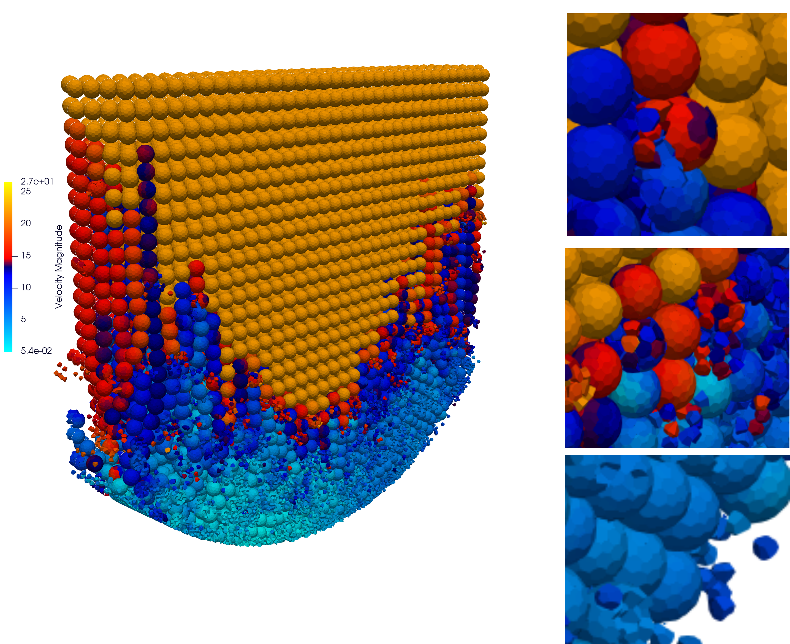
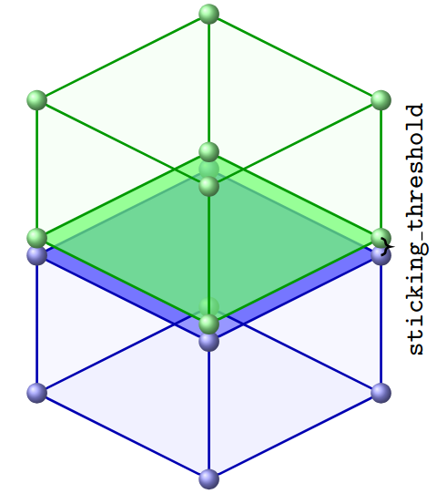
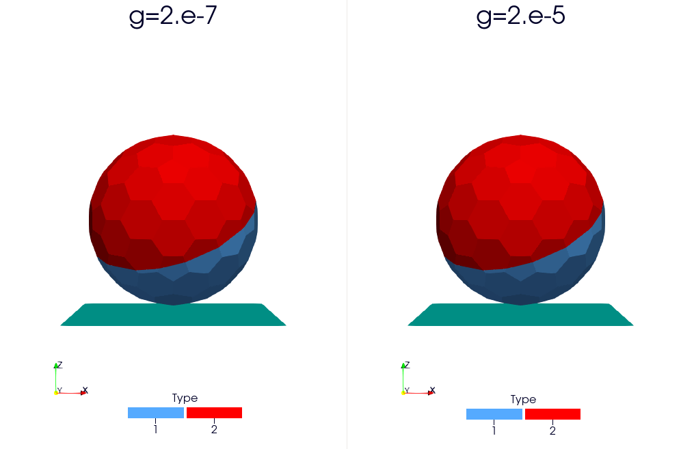

.. _exadem_fragmentation:

=============
Fragmentation
=============

``exaDEM`` can model a single grain as an assembly of several sphero-polyhedra (fragments) bonded together, and let that assembly break apart when the bond between two fragments is overloaded. This page describes the geometric mechanism (pre-cutting, sticking, interface breakage), the cohesive force law applied to a bond while it is intact, and the optional strategy used to keep the resulting contact stiffness physically consistent right after a bond breaks.

.. _fragmentation_mechanism:

Mechanism
=========

``exaDEM`` handles fragmentation by pre-cutting grains into small polyhedra and adding springs between opposite vertices to bond their faces together. To use this feature, include ``config_fragmentation.msp`` instead of ``config_polyhedra.msp``.

Particles stick together when the distance between opposite vertices falls below ``sticking_threshold`` (e.g. ``1.e-04``), set in the ``global`` block alongside ``apply_particle_sticking: true``.

At each time step, ``exaDEM`` then checks every interface -- a set of ``InnerBond`` interactions (type id 13, see the Interaction glossary on the :ref:`R-Shape / Polyhedron page <interaction_type_poly>`) -- to see whether the released energy exceeds a threshold that depends on the bonded surface area and a parameter ``g``.

When an interface breaks, its interactions are removed and the interaction lists are rebuilt. Note that two particles stuck together by an interface cannot have any other kind of contact (vertex-vertex, vertex-edge, etc.) between them at the same time.

.. _fragmentation_inner_bond_forces:

Inner Bond Forces
==================

The ``inner_bond_force`` law models a **cohesive bond** between two contacting
polyhedron faces, combining a linear elastic + viscous **normal** force, a
linear elastic **tangential** force accumulated over the contact history, and
a **fracture criterion** that breaks the bond once the stored elastic energy
exceeds a material-dependent threshold.

With overlap :math:`\delta = d_n - d_{n0}` and relative normal velocity :math:`v_n`:

.. math::

   f_n &= -k_n\, w\, \delta + \gamma\, v_n \\
   f_t &= w\, k_t\, \mathbf{t_{ds}}

where :math:`w` is the per-interaction weight and :math:`\gamma` is the
viscous damping coefficient derived from ``damp_rate``. The stored elastic
energies (tension only) are:

.. math::

   E_n &= \tfrac12\, w\, k_n\, \delta^2 \\
   E_t &= \tfrac12\, w\, k_t\, \lVert \mathbf{t_{ds}} \rVert^2

Inner Bond Parameters
----------------------

.. list-table::
   :header-rows: 1
   :widths: 12 10 78

   * - Name
     - Unit
     - Description
   * - ``kn``
     - force/length
     - Normal stiffness coefficient.
   * - ``kt``
     - force/length
     - Tangential stiffness coefficient.
   * - ``damp_rate``
     - dimensionless
     - Normal damping ratio.
   * - ``g``
     - energy/area
     - **MixedMode** fracture energy release rate. Mutually exclusive with
       ``gn``/``gt``. Breaks when :math:`E_n + E_t > 2\,A\,g`.
   * - ``gn``
     - energy/area
     - **SeparateModes** normal fracture energy release rate (requires ``gt``).
       Breaks when :math:`E_n > 2\,A\,g_n`.
   * - ``gt``
     - energy/area
     - **SeparateModes** tangential fracture energy release rate (requires ``gn``).
       Breaks when :math:`E_t > 2\,A\,g_t`.

.. note::

   Exactly one fracture mode must be configured: ``g`` alone (MixedMode), or
   ``gn`` together with ``gt`` (SeparateModes). Mixing the two, or omitting
   both, is rejected at parsing time.

Usage Examples
----------------

Single configuration (no groups), mixed-mode fracture:

.. code-block:: yaml

   inner_bond_params:
     kn: 10000 N/m
     kt: 8000 N/m
     damp_rate: 0.1
     g: 5.0 J/m^2

Single configuration (no groups), separate-mode fracture:

.. code-block:: yaml

   inner_bond_params:
     kn: 10000 N/m
     kt: 8000 N/m
     damp_rate: 0.1
     gn: 5.0 J/m^2
     gt: 2.0 J/m^2

With multiple groups, use the ``inner_bond_params`` operator with one entry
per ``(group1[p], group2[p])`` pair in parallel arrays:

.. note::

   Since ``exaDEM-1.2.3``, pairs are defined with ``group1``/``group2`` (particle group indices) instead of the former ``mat1``/``mat2`` (particle type names). Particle groups must be assigned beforehand via the ``group`` parameter of ``set_fields`` or the ``set_group`` operator.

.. code-block:: yaml

   - inner_bond_params:
      group1:    [      0,     0,     1 ]
      group2:    [      0,     1,     1 ]
      kn:        [   5000, 10000, 15000 ]
      kt:        [   4000,  8000, 12000 ]
      damp_rate: [  0.999, 0.999, 0.999 ]
      gn:        [   1e-5,  1e-5,  1e-5 ]
      gt:        [   1e-5,  1e-5,  1e-5 ]

   # or, mixed mode for every pair:
   - inner_bond_params:
      group1:    [      0,     1 ]
      group2:    [      0,     1 ]
      kn:        [   5000, 15000 ]
      kt:        [   4000, 12000 ]
      damp_rate: [  0.999,  0.999 ]
      g:         [   1e-5,   1e-5 ]

See also
----------

- ``stick_polyhedra`` — builds the inner-bond interactions and computes the
  fracture criterion's area term per bonded face.
- ``apply_interface_fracture_criterion`` — applies the configured rupture
  mode (mixed or separate) to decide whether a bonded interface breaks.

.. _fragmentation_weighted_contacts:

Weighted Contact Stiffness After Rupture
===========================================

When an inner bond breaks, the two fragments that were bonded can remain in
contact at several points at once (e.g. sharing a face, which is detected as
several simultaneous ``VertexVertex``/``VertexEdge``/``VertexFace``/``EdgeEdge``
interactions between the same pair of particles). Left untouched, each of
these sub-contacts applies the full user-defined ``kn``/``kt`` stiffness, so
the pair ends up with an effective stiffness that is a multiple of the
intended contact law -- stiffer than a single contact between two particles
of the same shape would be.

The ``number_weight_contact_polyhedron`` operator corrects for this. For
every active (overlapping) particle-particle polyhedron contact, it computes
a weight :math:`w_{ij} = 1 / N_{ij}`, where :math:`N_{ij}` is the number of
simultaneously active contact interactions currently detected between the
same pair of particles :math:`(i, j)`. This weight is stored per interaction
and used by ``contact_polyhedron`` to scale ``kn``/``kt`` down accordingly.
Pairs with a single active contact get :math:`w_{ij} = 1`, i.e. unchanged
behaviour.

.. note::

   This operator duplicates the geometric contact detection already performed
   by ``contact_polyhedron`` (on the ``CPU`` only), so it should only be added
   to the pipeline for fragmentation simulations where several simultaneous
   contacts between the same pair are expected right after rupture -- most
   simulations never run into this situation (at most one active contact per
   pair) and do not need it.

Add it to ``compute_force``, between ``classify_interactions`` and
``contact_polyhedron`` (or ``contact_multimat_polyhedron``):

.. code-block:: yaml

   compute_force:
     - gravity_force:
        gravity: [0,0,-9.81]
     - number_weight_contact_polyhedron
     - contact_multimat_polyhedron
     - inner_bond_polyhedron

* Operator name: ``number_weight_contact_polyhedron``
* Description: "NumberWeight" strategy -- computes, for every active particle-particle polyhedron contact, a weight :math:`1/N_{ij}` scaling ``kn``/``kt`` down, where :math:`N_{ij}` is the number of simultaneously active contacts currently detected between the same pair of particles.
* Parameters: none.
